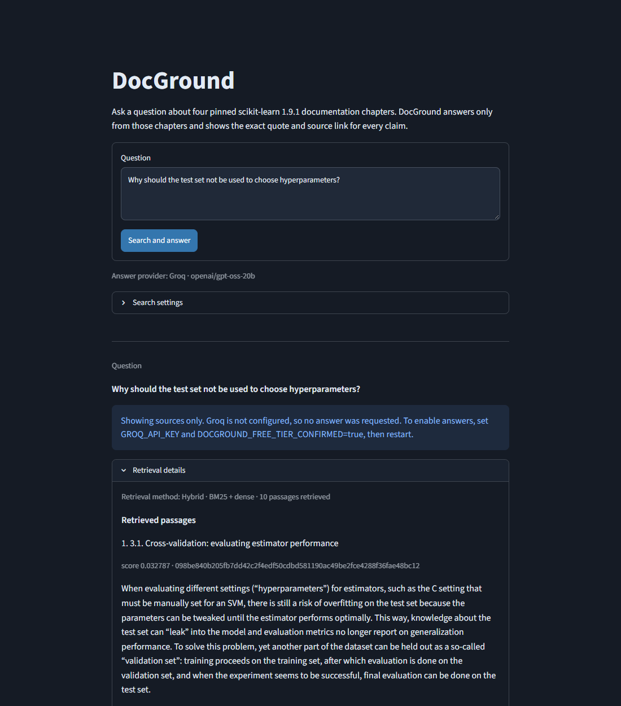

# DocGround

DocGround answers questions about four pinned scikit-learn 1.9.1 documentation chapters and shows the evidence behind each answer. It searches 228 chunks that keep their source coordinates, asks a language model for individually cited claims, and checks every quoted passage against the exact document revision. An answer with a citation that cannot be verified is rejected. A verified quote shows where the text came from. It does not prove that the claim is right.

**Groq is the recommended provider for a first run.** The Streamlit app also supports Gemini, which it uses when no provider is set. The generation results below come from `openai/gpt-oss-20b` on Groq. Gemini has no scored results. Retrieval and source inspection work without a provider key.



*Keyless retrieval demo with Groq selected. No answer was requested or generated.*

## Run the application

DocGround supports Python 3.14. From the repository root, activate a Python 3.14 virtual environment and run:

~~~sh
python -m pip install -r requirements-app.txt
python -m src.corpus fetch
python -m src.corpus build
python -m scripts.prepare_models
python -m streamlit run app.py
~~~

Setup downloads the pinned documentation pages and two local models of about 90 MB each. Encoding the corpus on CPU can take several minutes. The pinned corpus build was tested with Python 3.14.6. Linux CI uses the same requirements file. To recreate the measured Windows Python 3.14.6 environment, use `requirements-windows-py314.lock`.

Without provider configuration, a search shows a source-only notice and the retrieved sources.

To enable answers with Groq:

1. Copy `.env.example` to `.env`. It selects Groq.
2. Set `GROQ_API_KEY` in `.env`.
3. Set `DOCGROUND_FREE_TIER_CONFIRMED=true` only after verifying that the key belongs to a Groq Free Plan project.
4. Restart the app.

Closely spaced Groq submissions can hit the per-minute token limit.

To use Gemini instead, follow the [provider setup](docs/rag-engineering.md#provider-and-privacy). For the full offline test suite, run `python -m pytest tests -v`.

## Development results

The development split has 24 questions: 20 answerable and 4 unanswerable. These results guided development and come from a small sample. They do not estimate performance on unseen questions.

### Generation: Groq evaluation

These figures summarize a private development run. The 12/20 figure covers all answerable questions. The 12/13 figure covers only the reviewed answers.

| Measure | Result |
| --- | ---: |
| **Correct across all answerable questions** | **12/20 (60.0%)** |
| Correctness among reviewed answers | 12/13 (92.3%) |
| Citation failures across all questions | 7/24 (29.2%) |
| Answers with every claim supported | 12/13 |
| Claims adequately cited | 15/18 |
| Citations judged supporting | 19/19 |
| Unanswerable questions abstained on | 4/4 |

All seven citation failures were on answerable questions and count as not correct in 12/20. They were rejected by the citation check, were not retried, and were not reviewed. The remaining 13 answerable questions received answers. The scores for those answers are based on AI-assisted judgments from condensed review excerpts: an AI assistant presented the excerpts and suggested judgments, and one reviewer submitted the recorded judgments. They are not an independent human evaluation. The run used commit `2a23478`, prompt `grounded-claims-v3`, hybrid retrieval and temperature 0. Per-question outputs and reviews stay private.

### Retrieval

| Method at K=10 | Macro Unit Recall | Complete evidence |
| --- | ---: | ---: |
| BM25 | 92.5% | 18/20 |
| Dense MiniLM | 87.5% | 17/20 |
| **Hybrid (default)** | **95.0%** | **19/20** |
| Hybrid + reranker | 87.5% | 16/20 |

Hybrid's advantage over BM25 is one question. See the [archived retrieval report](reports/retrieval-comparison-v2/summary.md) for definitions, limits and all cutoffs.

## Documentation

- [Engineering guide](docs/rag-engineering.md): architecture, operations and limitations
- [Citation and outage protocol](docs/citation-and-outage-protocol.md): review rules and evaluation failure handling

## Provenance and license

This publication copy starts a new Git history. Commit and tree hashes in the README, experiments and archived reports, including `2a23478`, refer to the original project history. They are kept as recorded and cannot be checked out here, so instructions to replay a run at its recorded commit apply to that history. Input and artifact SHA-256 values can still be checked against the files they name.

The MiniLM window experiment compares its specification with an original commit, so `python -m experiments.minilm_windows` cannot run from this copy. The holdout freeze record is not included.

Original code is available under the [MIT License](LICENSE). scikit-learn documentation excerpts remain under their BSD 3-Clause license. See the [third-party notices](THIRD_PARTY_NOTICES.md).

## Reproduce Milestone 1

Use Python 3.14 and install dependencies with `python -m pip install -r requirements.txt`. Place the scikit-learn 1.9.1 chapter at `data/raw/common_pitfalls.html` and run these commands from the project root with the virtual environment active.

```console
python -m pytest tests/test_ingestion.py -q
python -m src.ingestion data/raw/common_pitfalls.html data/processed/common_pitfalls.json --expected-sha256 21FAC11C181AB35624DCF8673F0475D403D4F6ECF0F9BEAD01A573D7642B515C
```

The HTML declares the canonical source below. The `/stable/` URL can move to a newer release. The command checks the SHA-256 of the raw bytes before processing. The original snapshot is needed to reproduce the artifact. Both data directories are Git-ignored. [Common pitfalls and recommended practices](https://scikit-learn.org/stable/common_pitfalls.html)

## JSON schema version 1

| Field | Contents |
| --- | --- |
| `source` | Local filename, canonical or supplied URL, HTML title, documentation version when present in the scikit-learn title, and raw SHA-256 |
| `processing` | UTF-8 encoding, HTML parser name, and BeautifulSoup version |
| `sections` | Sections in heading order, with `id`, `parent_id`, `heading`, `level`, `heading_path`, `anchors`, and ordered `blocks` |

Paragraph and code blocks contain `text`. Lists store an `ordered` flag and an array of items, each containing blocks. Tables store a caption and rows with their group and cells. Each cell contains blocks, a header flag, and any explicit spans or `scope`. Collapsible panels store a summary, anchor, and nested blocks. Introductory text without a heading receives an untitled section.

Section IDs hash the source URL and preferred HTML anchor. For headings without anchors, the input uses the parent section ID, heading level and heading text. An occurrence counter disambiguates duplicates. Prose whitespace is normalized. Code retains the decoded text of `<pre>` elements, including indentation, prompts and displayed output.

The parser accepts recoverable HTML. It targets the main article and preserves textual content. Inline formatting, hyperlink destinations, images, and definition-list structure are outside this schema. The pinned chapter has no tables, so the suite tests table handling with a synthetic fixture.

## Milestone 2A — Chunking and evidence coordinates

Run once per processed schema-v1 document. Both file paths are required. The only configurable setting is `--max-chars`, a positive integer with a default of 1,200.

```console
python -m src.chunking data/processed/common_pitfalls.json data/processed/common_pitfalls.chunks.json --max-chars 1200
```

**Canonical text.** Traverse sections and blocks in stored array order. Emit paragraph and code text verbatim. Visit list items in order, a panel's summary before its contents, and a table's caption before its cells in row order. Skip absent or empty summaries and captions. Join the emitted strings with exactly two LF characters, including between sections. There is no added leading or trailing separator. Headings are metadata. A section with no emitted text contributes no chunks. The representation follows the processed JSON order, which can differ from the original HTML reading order.

**Packing.** Within a section, append a whole text field when the resulting chunk fits, counting the separator. Otherwise start a new chunk. Any single oversized field gets its own chunk, including long paragraphs and code listings. The limit counts Python Unicode code points. Blocks can share a chunk, and compound blocks can span several chunks. Packing has zero overlap. The canonical document text can be reconstructed by joining chunk texts with the same two LF characters.

### Chunk schema v1

The artifact stores `chunk_schema_version`, `max_chars`, and ordered `chunks`.

| Chunk field | Meaning |
| --- | --- |
| `document_id` | Revision-specific SHA-256 of the entire processed document, serialized as UTF-8 JSON with sorted keys, compact separators and literal Unicode. JSON file indentation has no effect. Changes to processing metadata create a new revision. |
| `source_sha256`, `source_url` | Raw HTML digest and documentation URL from ingestion. |
| `section_id`, `heading_path`, `anchor` | Owning section, heading hierarchy, and first section anchor or null. |
| `start`, `end`, `text` | Zero-based, half-open document character range and its exact canonical substring. The join between adjacent chunks occupies two characters outside both chunks. |
| `fields` | Ordered mappings with `path`, `start`, `end`, and `anchor`. The path is a JSON Pointer relative to the owning section, such as `/blocks/0/items/1/0/text`. Each range uses document coordinates. Panel fields inherit the closest available panel anchor. |
| `id` | SHA-256 of the compact UTF-8 JSON array `["chunk-v1", document_id, section_id, start, end]`. A range that survives repacking keeps its ID. |

### Evidence matching contract

Annotate each required evidence unit with `document_id`, `section_id`, `start`, and `end` in the canonical document. To translate a quote at local offsets `[a, b)` in a mapped JSON field, add that field's `start` to both offsets. Character offsets refer exclusively to the processed representation.

`evidence_coverage(required_units, chunks)` returns one Boolean per required unit in input order. Credit requires **one chunk to contain the entire nonempty span** in the same document revision and section. Its first and last characters must belong to mapped text fields. A unit can cross fields inside one chunk. Splitting that unit across two returned chunks earns zero credit for it. Shared words or headings earn no credit on their own.

For a question requiring multiple units, use `all(flags)` for full coverage or `sum(flags) / len(flags)` for the fraction covered. Different chunks may cover different units. Repeating a chunk gives no additional credit. This rule measures coverage of the annotated locations. Equivalent passages elsewhere require separate annotation policy. Table layout, list markers, and heading strings are excluded from the canonical body. Raw HTML byte positions and token counts are outside this coordinate system.

## Milestone 2B: BM25 retrieval

Run retrieval against the artifact produced by the chunking command above.

```console
python -m src.retrieval data/processed/common_pitfalls.chunks.json "train_test_split data leakage" --top-k 5
```

The command prints a JSON array of ranked chunks, each with its BM25 `score` and all original fields, including `id`, `text`, section and heading information, source URL and anchor, source SHA-256, and canonical character offsets. `--top-k` defaults to 5 and accepts positive integers. The ranker returns up to K positive-scoring matches. Blank queries, punctuation-only queries, and queries whose tokens are all unknown return `[]`. Unknown tokens in a mixed query are ignored. Exact score ties use ascending chunk ID.

BM25 uses `k1 = 1.2`, `b = 0.75`, and `log1p((N - df + 0.5) / (df + 0.5))` for inverse document frequency, where N is the number of chunks and df counts chunks with the term. Term frequencies and length are computed over chunk text. The ranker scans the chapter in memory. [Apache Lucene BM25Similarity parameter and IDF reference](https://lucene.apache.org/core/10_5_2/core/org/apache/lucene/search/similarities/BM25Similarity.html)

The tokenizer finds Unicode `\w+` runs, keeps compound identifiers, adds their underscore and ASCII camel-case components, and casefolds the results. Query terms are deduplicated before scoring. Document term frequencies count each emitted token. Heading paths serve as provenance. Phrase matching, stemming, semantic equivalence, and splitting case transitions outside ASCII are outside tokenizer v1.

| Input | Tokens |
| --- | --- |
| `train_test_split` | `train_test_split`, `train`, `test`, `split` |
| `StandardScaler` | `standardscaler`, `standard`, `scaler` |
| `Pipeline` | `pipeline` |

## Milestone 2B: Retrieval evaluation

Evaluate one human-reviewed split per invocation. Maintain separate files for `development` and `frozen-test`. Use development annotations for iteration and reserve frozen-test for a fixed protocol. The first [human-reviewed development pilot](annotations/development/pilot-v1.json) has ten questions. See the [review record](annotations/pilot-development-review.md) for evidence and provenance. The published [BM25 smoke test](reports/bm25-development-pilot-v1/publication-summary.md) uses this development split.

```console
python -m src.evaluation data/processed/common_pitfalls.chunks.json path/to/development.json --top-k 5
```

### Annotation schema v1

| Key | Contract |
| --- | --- |
| `annotation_schema_version` | Integer `1` |
| `annotation_version` | Nonempty revision string for the annotation set. Change it for edits to reviewed questions or evidence. |
| `corpus_revision` | Chunk artifact `document_id`, the SHA-256 of the canonical processed document serialized as sorted compact JSON |
| `split` | `development` or `frozen-test` |
| `questions` | Nonempty array of records with unique, stable `id` strings, nonempty `question` strings, boolean `answerable`, and an `evidence_units` array |

For an answerable question, each entry in `evidence_units` is a nonempty array of alternative spans for one required unit. Alternatives within a unit are interchangeable and all units are required. Unanswerable questions have `evidence_units: []`. This object shows the shape of one span using placeholder coordinates.

```json
{
  "section_id": "<section id>",
  "start_block_path": "/blocks/0/text",
  "end_block_path": "/blocks/1/text",
  "start": 0,
  "end": 42
}
```

Block paths are JSON Pointers to the canonical text fields relative to the section. Ranges are document-global, zero-based, and half-open in Unicode code points. The start and final included character must be in the specified fields of the same section. A span may cross fields, including the inserted separators. Coordinates are independent of chunk size. The evaluator rejects mismatched corpus revisions and invalid endpoints.

### Evaluation protocol v1

| Measure | Per-question rule |
| --- | --- |
| Precision@K | Retrieved relevant chunks divided by requested K. Unfilled ranks contribute zero. |
| Recall@K | Retrieved relevant chunks divided by all relevant chunks in the selected artifact. |
| MRR@K | Inverse rank of the first relevant chunk among the first K results, or zero when absent. |
| Complete Evidence Coverage@K | One when each required unit has an alternative fully contained in one of the first K chunks, otherwise zero. Separate chunks can satisfy separate units. |
| Retrieval latency | Wall-clock milliseconds per query around tokenization, ranking, and result materialization on an already-built index. |

A chunk is relevant when at least one of its source characters overlaps any annotated alternative in the same section. A chunk contributes at most once to relevance counts, even if it overlaps multiple spans. A span split across chunks may make both chunks relevant. Complete coverage still requires one chunk to contain the full span, using the Milestone 2A rule. If the chunk configuration splits every alternative for a unit, the unit cannot be covered with that artifact. Unannotated evidence and semantic or topical similarity receive no credit. Comparing relevance scores across chunk configurations changes the ground truth chunk set, even with the same annotation coordinates.

The four quality measures are macro-averaged across answerable questions. A split containing only unanswerable questions reports `null` for these averages. Unanswerable counts and their no-result counts are reported separately. A no-result count alone provides no measure of answerability detection. Mean latency includes all questions and excludes index construction, annotation validation, evaluation scoring, and JSON serialization. Timing varies by run and environment. The report records the corpus revision, source and exact chunk-artifact SHA-256 values, chunk size, tokenizer configuration, BM25 parameters, top K, split, annotation version, and evaluation protocol version.

## Milestone 3A — Prepare human annotations

Use the [human annotation guide](annotations/README.md) to browse canonical evidence, find exact quotations, review draft spans, and export a validated schema-v1 annotation file. The development and frozen-test locations are ready for human-reviewed data.

## Reproduce the BM25 development smoke test

See the [publication summary](reports/bm25-development-pilot-v1/publication-summary.md), [original measurement summary](reports/bm25-development-pilot-v1/summary.md), and [original JSON report](reports/bm25-development-pilot-v1/report.json). Use the publication checkout for the fetch script. The report records the measured implementation commit d1a7f4d25cba6dadc831115fa6a0b818c7476c45. It also records Python 3.14.6, BeautifulSoup 4.15.0, SoupSieve 4.1.2, typing-extensions 4.16.0, and pytest 9.2.0.

Run these commands from the root of a clean checkout with a Python 3.14.6 virtual environment active.

~~~console
python -m pip install -r requirements.txt soupsieve==4.1.2 typing-extensions==4.16.0
python -m scripts.fetch_common_pitfalls
python -m src.ingestion data/raw/common_pitfalls.html data/processed/common_pitfalls.json --expected-sha256 21fac11c181ab35624dcf8673f0475d403d4f6ecf0f9bead01a573d7642b515c
python -m src.chunking data/processed/common_pitfalls.json data/processed/common_pitfalls.chunks.json --max-chars 1200
python -m src.annotations data/processed/common_pitfalls.json review annotations/development/pilot-v1.json
~~~

The fetch starts at the reviewer-verified versioned endpoint and verifies the raw SHA-256. It reuses an existing matching file and refuses to replace any raw file. If the upstream bytes change, use a previously saved copy that matches the recorded SHA-256. Ingestion and chunking regenerate their destinations in the ignored processed directory. The HTML declares a canonical URL on the stable site. Let ingestion use that URL so the corpus revision reproduces.

Check all four hashes before running the evaluator. The command prints the raw, processed, chunk, and annotation digests, in that order. Compare them with the artifact table in the original summary.

~~~console
python -c "from hashlib import sha256; from pathlib import Path; print(*(sha256(Path(p).read_bytes()).hexdigest() for p in ('data/raw/common_pitfalls.html', 'data/processed/common_pitfalls.json', 'data/processed/common_pitfalls.chunks.json', 'annotations/development/pilot-v1.json')), sep=chr(10))"
~~~

Run all three commands twice. They print to standard output. Save any new runs separately from the archived reports. Compare ranked IDs, quality metrics, and coverage flags while allowing latency to vary.

~~~console
python -m src.evaluation data/processed/common_pitfalls.chunks.json annotations/development/pilot-v1.json --top-k 1
python -m src.evaluation data/processed/common_pitfalls.chunks.json annotations/development/pilot-v1.json --top-k 3
python -m src.evaluation data/processed/common_pitfalls.chunks.json annotations/development/pilot-v1.json --top-k 5
~~~

## Rebuild the pinned multi-document corpus

[Corpus manifest v1](corpus/scikit-learn-1.9.1-v1.json) pins four pages from scikit-learn 1.9.1. The upstream versioned URLs use the `/1.9/` series, which can change at a patch release. The manifest checks the exact bytes of each snapshot, and the builder checks that every page declares 1.9.1. Source attribution and the [release's BSD 3-Clause license](https://github.com/scikit-learn/scikit-learn/blob/1.9.1/COPYING) travel with both artifacts.

From the repository root, with the Python 3.14.6 virtual environment active, run:

~~~console
python -m pip install -r requirements.txt soupsieve==4.1.2 typing-extensions==4.16.0
python -m src.corpus fetch
python -m src.corpus build
~~~

The fetch command reuses matching HTML in `data/raw/`, checks each download before writing, and refuses to overwrite an existing snapshot. If an upstream page changes, use a local copy with the manifest's SHA-256. To use another manifest or raw directory, pass `--manifest PATH` or `--raw-dir PATH`. The builder reads the verified snapshots and writes `documents.json` and `chunks.json` to `data/processed/corpus-v1/`. The original single-document CLI and its paths still reproduce Milestone 4.

The corpus schema wraps the existing schema-v1 documents and chunk artifacts in manifest order. Both wrappers record the corpus version, canonical manifest SHA-256 (sorted compact UTF-8 JSON), and attribution. Each entry has a manifest `id`, a pinned download `url` and `sha256`, and a content-specific `document_id`. The inner document retains its HTML canonical URL for section identity and source citation. Offsets restart at zero for every document. Evidence is identified by `document_id`, `section_id`, and its document-local range. The matcher requires these together and the builder rejects duplicate revision, section, and chunk IDs across documents.

| Document | Sections | Chunks |
| --- | ---: | ---: |
| Common pitfalls | 15 | 27 |
| Pipelines and composite estimators | 13 | 25 |
| Cross-validation | 27 | 46 |
| Model evaluation | 55 | 130 |
| Total | 110 | 228 |

To verify a second build, use `python -m src.corpus build --output-dir data/processed/corpus-v1-check` and compare both files with the first build. The expected SHA-256 values for Python 3.14.6 and the dependencies above are:

| Artifact | SHA-256 |
| --- | --- |
| `documents.json` | `83898f9410710eb4f7acf3b97d0602235687a86ed7ededa0fb002bcca75edfab` |
| `chunks.json` | `cee1cbdfc77457a77a6a1741bd72937f8095c511f0b4c4208616367e7dcfa882` |

The parser keeps code whitespace, table cell order and explicit spans, and text inside collapsible panels. Figures and plots are represented only by any extracted surrounding text or captions. Math markup can contribute text but is not rendered or interpreted. Definition lists are flattened, and inline markup and hyperlink destinations are discarded. The existing 1,200-character packing rule keeps oversized text fields whole. The expanded wrappers are corpus build artifacts. The nested artifacts retain their single-document schemas.

## Multi-document annotations and evaluation

Use the corpus wrappers produced by `python -m src.corpus build`. These commands browse all documents or restrict a literal search to one manifest ID.

~~~console
python -m src.annotations data/processed/corpus-v1/documents.json browse
python -m src.annotations data/processed/corpus-v1/documents.json find "cross-validation" --document cross_validation
~~~

Corpus drafts use `annotation_schema_version: 2`. Copy the printed corpus revision into the draft's `corpus_revision`. It is the existing canonical JSON digest of the array `["corpus-v1", manifest_sha256, ordered_document_revisions]`. This binds the draft to the ordered manifest and processed content. Each span from `find` includes **both** `manifest_id` (such as `compose`) and `document_id` (the full processed-document revision digest). Preserve them along with the section ID, endpoint field paths and half-open document-local offsets. The remaining draft fields follow schema v1. Different units or alternatives can reference different documents. Repeated text can be credited only at an approved location.

Use `review` and `export` with the same documents wrapper and the draft path. For an independently reviewed schema-v2 dataset, the existing retrieval and evaluation commands accept the chunks wrapper:

~~~console
python -m src.retrieval data/processed/corpus-v1/chunks.json "QUERY" --top-k 5
python -m src.evaluation data/processed/corpus-v1/chunks.json PATH_TO_REVIEWED_V2_ANNOTATIONS --top-k 5
~~~

BM25 computes document frequencies and average chunk length across all chunks in the wrapper. Returned chunks include their manifest ID and pinned snapshot URL alongside the original revision, source hash, canonical URL, anchors and field ranges. Evaluation protocol v1 retains its cutoffs, overlap rule for chunk relevance, single-chunk containment rule for evidence units, aggregation, timing and unanswerable policy. Corpus reports carry an ordered `sources` array of document identities, URLs, and hashes. Single-document inputs retain annotation schema v1, their original report shape, and their original CLI commands.

## Reproduce the multi-document BM25 development baseline

Build the pinned corpus using the commands above, then run the benchmark from the repository root with the same virtual environment active. To replay an archived run, use a checkout at the `git_commit` recorded in its report.

~~~console
python -m scripts.benchmark_bm25_development
~~~

The runner verifies the SHA-256 of `annotations/development/multi-document-v1.json`, `data/processed/corpus-v1/chunks.json` (228 chunks), and `corpus/scikit-learn-1.9.1-v1.json` before issuing queries. It takes no dataset path and uses the existing BM25 and tokenizer at K=1, 3, 5, and 10.

The CLI requires committed source and scripts. It records HEAD as `git_commit` and the corresponding Git tree as `git_tree`. The report is generated from the implementation commit and archived in a later commit. The regression suite compares two independent Python processes with `PYTHONHASHSEED` values 11 and 97. It uses synthetic pinned inputs and compares the benchmark output and BM25 hit scores, omitting retrieval latency.

Macro Unit Recall averages each answerable question's fraction of covered required units. A unit earns credit once when one returned chunk fully contains an approved alternative in the correct document revision and section. The report distinguishes BM25 ranking misses from units that no chunk can fully contain. It records result counts for unanswerable questions as retrieval behavior.

Category labels are for reporting. The direct-factual IDs come from the [reviewed development draft](annotations/development-question-draft.md#direct-factual). Other answerable questions are grouped by their unit count and whether one document offers an approved alternative for every required unit. Unanswerable status comes from the approved export. Category assignment uses the annotations before retrieval and leaves the export intact.

See the [benchmark summary](reports/bm25-development-multi-document-v1/summary.md) and [machine-readable report](reports/bm25-development-multi-document-v1/report.json) for the measured results, input digests, and repeatability check.
